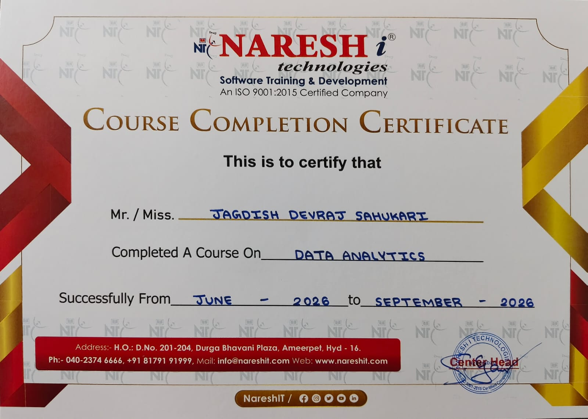
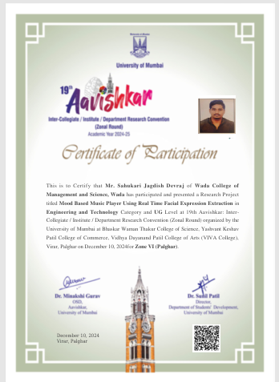

# Certifications and Achievements

Certificates and academic recognition that support my profile as an aspiring Data Analyst.

---

## Certifications

### Data Analytics: Naresh i Technologies, Hyderabad
- **Type:** Course Completion Certificate
- **Duration:** June 2026 to September 2026
- **Issued by:** Naresh i Technologies (an ISO 9001:2015 certified company)



My portfolio projects on GitHub were built using the skills from this course, including SQL, data cleaning, analysis and dashboards.

---

## Achievements

### Avishkar 2024: Research Convention, University of Mumbai
- **Event:** 19th Avishkar Inter-Collegiate / Inter-Institute / Department Research Convention (Zonal Round), Academic Year 2024-25
- **Category:** Engineering and Technology, UG level
- **Project:** *Mood Based Music Player Using Real Time Facial Expression Extraction*
- **Zone:** VI (Palghar)
- **Date:** 10 December 2024
- **Recognition:** Certificate of Participation. I presented the project at the zonal round of the convention organised by the University of Mumbai.



---

## Education

**B.Sc. Data Science**: Wada College of Management and Science, University of Mumbai
Graduated 2025 | CGPI: 9.55 / 10

---

## Repository Structure

```
certifications-and-achievements/
├── certificates/
│   ├── naresh-it-data-analytics-certificate.jpeg
│   └── avishkar-2024-participation-certificate.png
└── README.md
```

---

## Author

**Jagdish Sahukari**
[LinkedIn](https://www.linkedin.com/in/jagdish-sahukari-49064b312) · [GitHub](https://github.com/jagdishsahukari)
